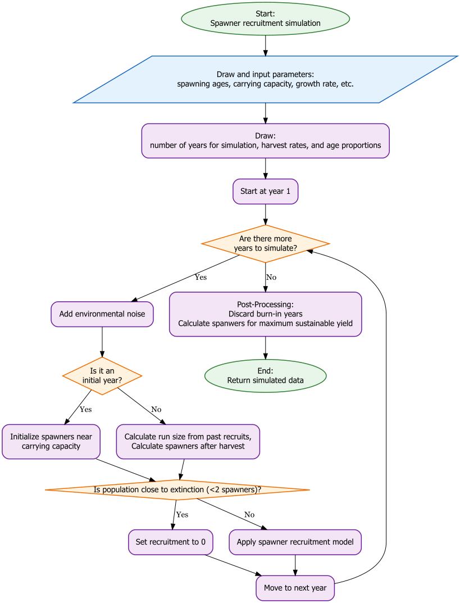

---
author:
- name: Maria Kuruvilla
author_summary: null
output:
  word_document: 
    toc: true
  html_document:
    toc: true
    toc_float: true
    df_print: paged
  pdf_document: default
bibliography: mybibfile.bib
csl: http://www.zotero.org/styles/plos
title: "Parameter estimation in fishery models"
---

```{r setup, include=FALSE}
knitr::opts_chunk$set(warning = FALSE, echo = FALSE)
knitr::opts_chunk$set(warning = FALSE)
knitr::opts_chunk$set(cache=FALSE)
knitr::opts_chunk$set(fig.width=7, fig.height=5)
options(max.print=23)
library(here);library(dplyr); library(stringr)
library(ggplot2)
library(tidyverse)
library(bayesplot)
library(patchwork)
library(hues)
library(GGally)
library(latex2exp)
library(ggforce)
library(PNWColors)
library(DiagrammeR)
library(DiagrammeRsvg)
library(rsvg)
library(magrittr)

pal <- PNWColors::pnw_palette("Starfish", 5)

```

<!-- _Text based on plos sample manuscript, see <https://journals.plos.org/ploscompbiol/s/latex>_ -->

# Introduction

Fish population dynamics models have been used for several decades to describe the relationship between spawner abundance and future recruitment. The parameters in these models are estimated and used to predict the population size in the future, to manage fisheries, and more recently to understand factors (physical, biological, or anthropogenic) that cause changes in fish populations. However, the parameters in these complex models may not be uniquely identifiable. We used simulations, profile likelihood, and Bayesian hierarchical modelling to check the limitations of commonly used fisheries models, such as the Ricker and the Beverton-Holt model. We provide some guidelines on the most appropriate use cases for these models.


## Simulation

We simulated the Beverton-Holt and the Ricker population dynamics with randomly drawn values of $\alpha$, $\sigma$, $K$, and starting population size. We then fit both the Beverton-Holt model and the Ricker model in Bayesian framework to the data for log recruits per spawner $\ln(\frac{R}{S})$ to estimate the same parameters. We plotted the median estimates of these parameters with  95% credible intervals along with the true values of the parameters to evaluate the accuracy and precision of the parameter estimates.


### Base model

#### Beverton-Holt Model

$\ln(\frac{R}{S}) = e^{\alpha} - \ln(1 + \frac{e^{\alpha} S}{R_k}) + \epsilon$

$R_K = \frac{K}{e^{\alpha}-1}$

$S_{MSY} =  \frac{K}{e^{\frac{\alpha}{2}}+1}$

$\epsilon \sim N(0,\sigma)$

#### Ricker Model

$\ln(\frac{R}{S}) = \alpha - \frac{S}{S_{max}} + \epsilon$

$S_{max} = \frac{K}{\alpha}$

$S_{MSY} =  (1-W_0(e^{1 - \alpha}))S_{max}$

$\epsilon \sim N(0,\sigma)$


```{r echo=FALSE, message=FALSE, warning=FALSE}

simulation_results_wo_age <- read_csv(here("simulation",
                                           "stan_models",
                                           "output",
                                           "simulation_fitting_results_wo_age_200.csv"))


ggplot(simulation_results_wo_age %>% 
         filter(parameter == "alpha"), aes(x = alpha, y = estimate_median)) +
  # geom_point(aes(color = alpha),alpha = 0.5, size = 2) +
  geom_pointrange(aes(ymin= estimate_lower, ymax = estimate_upper, color = sigma), size = 0.5, alpha = 0.5)+
  geom_abline(slope = 1, intercept = 0, linetype = "dashed") +
  facet_wrap(~ paste("Data model: ",generating_model) + paste("Fitting model: ",fitting_model)) +
  labs(x = "True alpha", y = "Estimated alpha") +
  # scale_color_gradient2(name = 'alpha',
  #                       low = pal[2], mid = 'gray', high = pal[4], midpoint = 5) +
  scale_color_gradientn(name = 'sigma',
                        colors = pal)+
  theme_classic()


```


```{r}

# Create the flowchart using Graphviz (DOT language)
flowchart <- grViz("
digraph G {
  graph [layout = dot, rankdir = TD, nodesep = 0.4, ranksep = 0.5]

  # Global font settings
  node [fontname = 'Helvetica', style = 'filled', penwidth = 1.5]

  # ---------------------------------------------------
  # 1. START / STOP (Ovals)
  # ---------------------------------------------------
  node [shape = oval, fillcolor = '#e8f5e9', color = '#2e7d32']
  Start [label = 'Start:\\nSpawner recruitment simulation']
  End [label = 'End:\\nReturn simulated data']

  # ---------------------------------------------------
  # 2. INPUT / OUTPUT (Parallelograms)
  # ---------------------------------------------------
  node [shape = parallelogram, fillcolor = '#e3f2fd', color = '#1565c0']
  Input [label = 'Draw and input parameters:\\nspawning ages, carrying capacity, growth rate, etc.']

  # ---------------------------------------------------
  # 3. DECISIONS (Diamonds)
  # ---------------------------------------------------
  node [shape = diamond, fillcolor = '#fff3e0', color = '#ef6c00', margin = 0]
  CheckLoop [label = 'Are there more\\nyears to simulate?']
  CheckMaxAge [label = 'Is it an\\ninitial year?']
  CheckExtinction [label = 'Is population close to extinction (<2 spawners)?']

  # ---------------------------------------------------
  # 4. PROCESSES (Rounded Rectangles)
  # ---------------------------------------------------
  node [shape = box, style = 'filled,rounded', fillcolor = '#f3e5f5', color = '#6a1b9a', margin = 0.2]
  Prep [label = 'Draw:\\n number of years for simulation, harvest rates, and age proportions']
  InitLoop [label = 'Start at year 1']
  DrawNoise [label = 'Add environmental noise']
  
  InitS [label = 'Initialize spawners near\\ncarrying capacity']
  CalcRun [label = 'Calculate run size from past recruits,\\nCalculate spawners after harvest']
  
  SetZero [label = 'Set recruitment to 0']
  CalcBH [label = 'Apply spawner recruitment model']
  
  NextT [label = 'Move to next year']
  
  PostProc [label = 'Post-Processing:\\nDiscard burn-in years\\nCalculate spanwers for maximum sustainable yield']

  # ---------------------------------------------------
  # 5. EDGE CONNECTIONS
  # ---------------------------------------------------
  Start -> Input
  Input -> Prep
  
  # Setup and Loop Start
  Prep -> InitLoop
  InitLoop -> CheckLoop
  
  # Inside the Loop
  CheckLoop -> DrawNoise [label = ' Yes']
  DrawNoise -> CheckMaxAge
  
  # Age Check Branch
  CheckMaxAge -> InitS [label = ' Yes']
  CheckMaxAge -> CalcRun [label = ' No']
  
  # Extinction Check Branch
  InitS -> CheckExtinction
  CalcRun -> CheckExtinction
  
  CheckExtinction -> SetZero [label = ' Yes']
  CheckExtinction -> CalcBH [label = ' No']
  
  # End of Loop Iteration
  SetZero -> NextT
  CalcBH -> NextT
  NextT -> CheckLoop
  
  # Loop Finished
  CheckLoop -> PostProc [label = ' No']
  PostProc -> End
}
")

# Convert the graph to a PNG image and save it to your folder
export_svg(flowchart) %>% charToRaw() %>% rsvg_png("bh_algorithm_flowchart.png")

# Insert the PNG image into the Word document


```

We simulated the population dynamics of salmon using two spawner recruit models - Ricker and Beverton-Holt. The simulation models contained submodels for recruitment, harvest and age-structure, with natural variability in recruitment, harvest, and age-at-maturity.

We simulated 300 different datasets and fit both the Ricker model and the Beverton-Holt model to these datasets. We then estimated the parameters and compared them to the true values.


```{r echo=FALSE, message=FALSE, warning=FALSE}

simulation_results_diff_pars <- read_csv(here("simulation",
                                              "stan_models",
                                              "output",
                                              "simulation_fitting_results_w_age_sim_383.csv"))

 
ggplot(simulation_results_diff_pars %>% 
         filter(parameter == "alpha"), aes(x = alpha, y = estimate_median)) +
  # geom_point(aes(color = alpha),alpha = 0.5, size = 2) +
  geom_pointrange(aes(ymin= estimate_lower, ymax = estimate_upper, color = sigma), size = 0.5, alpha = 0.5)+
  geom_abline(slope = 1, intercept = 0, linetype = "dashed") +
  facet_wrap(~ paste("Data model: ",generating_model) + paste("Fitting model: ",fitting_model)) +
  labs(x = "True alpha", y = "Estimated alpha") +
  # scale_color_gradient2(name = 'alpha',
  #                       low = pal[2], mid = 'gray', high = pal[4], midpoint = 5) +
  scale_color_gradientn(name = 'sigma',
                        colors = pal)+
  theme_classic()

ggplot(simulation_results_diff_pars %>% 
         filter(parameter == "Smsy"), aes(x = Smsy, y = estimate_median)) +
  # geom_point(aes(color = alpha),alpha = 0.5, size = 2) +
  geom_pointrange(aes(ymin= estimate_lower, ymax = estimate_upper, color = sigma), size = 0.5, alpha = 0.5)+
  coord_trans(y="log10") + 
  geom_abline(slope = 1, intercept = 0, linetype = "dashed") +
  scale_y_continuous(labels = scales::comma, breaks = c(1000, 10000, 100000)) +
  
  facet_wrap(~ paste("Data model: ",generating_model) + paste("Fitting model: ",fitting_model)) +
  labs(x = "True S_MSY", y = "Estimated S_MSY") +
  # scale_color_gradient2(name = 'alpha',
  #                       low = pal[2], mid = 'gray', high = pal[4], midpoint = 5) +
  scale_color_gradientn(name = 'sigma',
                        colors = pal)+
  theme_classic()


```

We then simulated 1 dataset with the same parameter values and fit the Ricker model and the Beverton-Holt model 1000 times. We then plotted the estimated median of the alpha parameter. 

```{r echo=FALSE, message=FALSE, warning=FALSE}

simulation_results_same_pars <- read_csv(here("simulation",
                                              "stan_models",
                                              "output",
                                              "simulation_fitting_results_w_age_same_pars_1000.csv"))

simulation_results_same_pars %>%
  ggplot() +
  # geom_histogram(aes(x = alpha_estimate, fill = fitting_model), position = "dodge", bins = 30) +
  geom_density(aes(x = alpha_estimate, fill = fitting_model, lty = generating_model), alpha = 0.5, color = "black") +
  geom_vline(aes(xintercept = alpha, color = "alpha"), lty = "dashed", size = 1) +
  labs(title = "Distribution of alpha estimates for BH and Ricker fitting models", x = "Alpha estimate", y = "Density") +
  scale_fill_manual(name = "Fitting model", values = c( "#807182","#99C2A2")) +
  scale_color_manual(name = "True value", values = c("alpha" = "slategray")) +
  scale_linetype_manual(name = "Generating model", values = c("Beverton-Holt" = "solid", "Ricker" = "dashed")) +
  theme_classic()


# simulation_results_same_pars_low_alpha <- read_csv(here("simulation",
#                                               "stan_models",
#                                               "output",
#                                               "simulation_fitting_results_w_age_same_pars_low_alpha_low_sigma_100.csv"))
# 
# simulation_results_same_pars_low_alpha %>%
#   # filter(fitting_model == "Ricker", generating_model == "Ricker") %>% 
#   ggplot() +
#   # geom_histogram(aes(x = alpha_estimate, fill = fitting_model), position = "dodge", bins = 30) +
#   geom_density(aes(x = alpha_estimate, fill = fitting_model, lty = generating_model), alpha = 0.5, color = "black") +
#   geom_vline(aes(xintercept = alpha, color = "alpha"), lty = "dashed", size = 1) +
#   xlim(0,3)+
#   labs(title = "Distribution of alpha estimates for BH and Ricker fitting models", x = "Alpha estimate", y = "Density") +
#   scale_fill_manual(name = "Fitting model", values = c( "#807182","#99C2A2")) +
#   scale_color_manual(name = "True value", values = c("alpha" = "slategray")) +
#   scale_linetype_manual(name = "Generating model", values = c("Beverton-Holt" = "solid", "Ricker" = "dashed")) +
#   theme_classic()


```


In addition to simulating data from the base model, we simulated data with covariates: 1) Sea-surface temperature (SST), 2) Forestry. 


### Model with one covariate

#### SST


We used Extended Reconstructed Sea-Surface Temperature from the NOAA website from 1925 to 2025.


##### Beverton-Holt Model

$\ln(\frac{R}{S}) = e^{\alpha} - \ln(1 + \frac{e^{\alpha} S}{R_k}) + \beta SST + \epsilon$

$R_K = \frac{K}{e^{\alpha}-1}$

$\epsilon \sim N(0,\sigma)$

##### Ricker Model

$\ln(\frac{R}{S}) = \alpha - \frac{S}{S_{max}} + \beta SST + \epsilon$

$S_{max} = \frac{K}{\alpha}$

$\epsilon \sim N(0,\sigma)$


```{r echo=FALSE, message=FALSE, warning=FALSE}

simulation_results_diff_pars_w_covariate <- read_csv(here("simulation",
                                              "stan_models",
                                              "output",
                                              "simulation_fitting_results_w_covariate_sst_100.csv"))

 
# ggplot(simulation_results_diff_pars_w_covariate %>% 
#          filter(parameter == "alpha"), aes(x = alpha, y = estimate_median)) +
#   # geom_point(aes(color = alpha),alpha = 0.5, size = 2) +
#   geom_pointrange(aes(ymin= estimate_lower, ymax = estimate_upper, color = sigma), size = 0.5, alpha = 0.5)+
#   geom_abline(slope = 1, intercept = 0, linetype = "dashed") +
#   facet_wrap(~ paste("Data model: ",generating_model) + paste("Fitting model: ",fitting_model)) +
#   labs(x = "True alpha", y = "Estimated alpha") +
#   # scale_color_gradient2(name = 'alpha',
#   #                       low = pal[2], mid = 'gray', high = pal[4], midpoint = 5) +
#   scale_color_gradientn(name = 'sigma',
#                         colors = pal)+
#   theme_classic()


ggplot(simulation_results_diff_pars_w_covariate %>% 
         filter(parameter == "b_cov"), aes(x = b_cov, y = estimate_median)) +
  # geom_point(aes(color = alpha),alpha = 0.5, size = 2) +
  geom_pointrange(aes(ymin= estimate_lower, ymax = estimate_upper, color = sigma), size = 0.5, alpha = 0.5)+
  geom_abline(slope = 1, intercept = 0, linetype = "dashed") +
  facet_wrap(~ paste("Data model: ",generating_model) + paste("Fitting model: ",fitting_model)) +
  labs(x = "True beta", y = "Estimated beta") +
  # scale_color_gradient2(name = 'alpha',
  #                       low = pal[2], mid = 'gray', high = pal[4], midpoint = 5) +
  scale_color_gradientn(name = 'sigma',
                        colors = pal)+
  theme_classic()


```

#### Forestry


For the forestry data, we used the cumulative disturbed area in the Carnation Creek watershed as the covariate. This is a monotonically increasing covariate.


##### Beverton-Holt Model

$\ln(\frac{R}{S}) = e^{\alpha} - \ln(1 + \frac{e^{\alpha} S}{R_k}) + \beta Forestry + \epsilon$

$R_K = \frac{K}{e^{\alpha}-1}$

$\epsilon \sim N(0,\sigma)$

##### Ricker Model

$\ln(\frac{R}{S}) = \alpha - \frac{S}{S_{max}} + \beta Forestry + \epsilon$

$S_{max} = \frac{K}{\alpha}$

$\epsilon \sim N(0,\sigma)$


```{r echo=FALSE, message=FALSE, warning=FALSE}

simulation_results_diff_pars_w_covariate_for <- read_csv(here("simulation",
                                              "stan_models",
                                              "output",
                                              "simulation_fitting_results_w_covariate_forestry_100.csv"))

 
# ggplot(simulation_results_diff_pars_w_covariate_for %>% 
#          filter(parameter == "alpha"), aes(x = alpha, y = estimate_median)) +
#   # geom_point(aes(color = alpha),alpha = 0.5, size = 2) +
#   geom_pointrange(aes(ymin= estimate_lower, ymax = estimate_upper, color = sigma), size = 0.5, alpha = 0.5)+
#   geom_abline(slope = 1, intercept = 0, linetype = "dashed") +
#   facet_wrap(~ paste("Data model: ",generating_model) + paste("Fitting model: ",fitting_model)) +
#   labs(x = "True alpha", y = "Estimated alpha") +
#   # scale_color_gradient2(name = 'alpha',
#   #                       low = pal[2], mid = 'gray', high = pal[4], midpoint = 5) +
#   scale_color_gradientn(name = 'sigma',
#                         colors = pal)+
#   theme_classic()


 


ggplot(simulation_results_diff_pars_w_covariate_for %>% 
         filter(parameter == "b_cov"), aes(x = b_cov, y = estimate_median)) +
  # geom_point(aes(color = alpha),alpha = 0.5, size = 2) +
  geom_pointrange(aes(ymin= estimate_lower, ymax = estimate_upper, color = sigma), size = 0.5, alpha = 0.5)+
  geom_abline(slope = 1, intercept = 0, linetype = "dashed") +
  facet_wrap(~ paste("Data model: ",generating_model) + paste("Fitting model: ",fitting_model)) +
  labs(x = "True beta", y = "Estimated beta") +
  # scale_color_gradient2(name = 'alpha',
  #                       low = pal[2], mid = 'gray', high = pal[4], midpoint = 5) +
  scale_color_gradientn(name = 'sigma',
                        colors = pal)+
  theme_classic()


```


## Data Cloning

To test parameter estimability using data cloning, we cloned the data $k$ times, we then fit the Ricker model and the Beverton-Holt model in a Bayesian framework to this dataset. We plotted the posterior variance of the alpha parameter to evaluate the rate of shrinkage of the posterior variance. If the parameter is non-estimable or practically inestimable, the posterior variance will not shrink towards 0 [@Peacock_Krkošek_Lewis_Lele_2017].


```{r echo=FALSE, message=FALSE, warning=FALSE}

data_cloning <- read_csv(here("simulation",
                                              "stan_models",
                                              "output",
                                              "data_cloning.csv"))

 
#scaling variance

scaled_variance <- data_cloning %>% 
  select(estimate_variance, parameter, fitting_model, generating_model, clones) %>% 
  group_by(parameter, fitting_model, generating_model) %>%
  mutate(scaled_variance = estimate_variance/estimate_variance[clones==1]) %>% 
  ungroup()


#plot variance as a function of clones

#plot variance as a function of clones
ggplot(scaled_variance )+
  # Changed x to 'clones'
  geom_line(aes(x = clones, y = scaled_variance, group = parameter, 
                color = parameter), size = 1.2, alpha = 0.5)+
  geom_point(aes(x = clones, y = scaled_variance, color = parameter), size = 3, alpha = 0.2) +
  
  facet_grid(generating_model~fitting_model, scales = "free", labeller = labeller(
    generating_model = c("Beverton-Holt" = "Generating Model: Beverton-Holt", 
                         "Ricker" = "Generating Model: Ricker"),
    fitting_model = c("Beverton-Holt" = "Fitting Model: Beverton-Holt", 
                      "Ricker" = "Fitting Model: Ricker"))) +
  
  # Log scale makes the 1/k curve a straight line, vastly improving readability
  # scale_x_continuous(trans = "log2", breaks = c(1, 2, 4, 8, 16)) +
  # scale_y_continuous(trans = "log2", breaks = c(0.001, 0.1, 0.5, 1)) +
  # 
  labs(x = "Number of Clones (k)", y = "Scaled Variance", color = "Parameter")+
  stat_function(
    fun = function(x) 1/x, 
    aes(color = "Ideal (1/k)"), 
    linetype = "dashed", 
    size = 1,
    alpha = 0.7
  ) +
  scale_color_manual(
    values = c("Ideal (1/k)" = "black", 
               "alpha" = "#1B9E77", 
               "sigma" = "#D95F02", 
               "K" = "#7570B3", 
               "Smsy" = "#E7298A"),
    name = "Parameter"
  ) +
  theme_classic()


data_cloning <- read_csv(here("simulation",
                              "stan_models",
                              "output",
                              "data_cloning.csv"))

data_cloning_low_S <- read_csv(here("simulation",
                              "stan_models",
                              "output",
                              "data_cloning_low_S.csv"))

data_cloning_low_sigma <- read_csv(here("simulation",
                              "stan_models",
                              "output",
                              "data_cloning_low_sigma.csv"))

data_cloning_high_sigma <- read_csv(here("simulation",
                              "stan_models",
                              "output",
                              "data_cloning_high_sigma.csv"))

#combine datasets with a column for low sigma, high sigma, low spawner abundance

data_cloning_combined <- rbind(data_cloning %>% mutate(scenario = "base"),
                               data_cloning_low_S %>% mutate(scenario = "low minimum spawner abundance"),
                               data_cloning_low_sigma %>% mutate(scenario = "low sigma"),
                               data_cloning_high_sigma %>% mutate(scenario = "high sigma"))

scaled_variance_combined <- data_cloning_combined  %>% 
  select(estimate_variance, parameter, fitting_model, generating_model, clones, scenario) %>% 
  group_by(parameter, fitting_model, generating_model, scenario) %>%
  mutate(scaled_variance = estimate_variance/estimate_variance[clones==1]) %>% 
  ungroup()


  
# make one figure for just alpha with multiple lines for the different datasets

#plot variance as a function of clones
ggplot(scaled_variance_combined %>% filter(parameter == "alpha", clones <30, scenario != "high sigma"))+
  # Changed x to 'clones'
  geom_line(aes(x = clones, y = scaled_variance, group = scenario, color = scenario), size = 1.2, alpha = 0.5)+
  geom_point(aes(x = clones, y = scaled_variance, color = scenario), size = 3) +
  
  facet_grid(generating_model~fitting_model, scales = "free", labeller = labeller(
    generating_model = c("Beverton-Holt" = "Generating Model: Beverton-Holt", 
                         "Ricker" = "Generating Model: Ricker"),
    fitting_model = c("Beverton-Holt" = "Fitting Model: Beverton-Holt", 
                      "Ricker" = "Fitting Model: Ricker"))) +
  
  # Log scale makes the 1/k curve a straight line, vastly improving readability
  # scale_x_continuous(trans = "log2", breaks = c(1, 2, 4, 8, 16)) +
  # scale_y_continuous(trans = "log2", breaks = c(0.001, 0.1, 0.5, 1)) +
  # 
  labs(x = "Number of Clones (k)", y = "Scaled Variance", color = "Parameter")+
  stat_function(
    fun = function(x) 1/x, 
    aes(color = "Ideal (1/k)"), 
    linetype = "dashed", 
    size = 1,
    alpha = 0.7
  ) +
  scale_color_manual(
    values = c("Ideal (1/k)" = "black", 
               "base" = "gray", 
               "low sigma" = "#1B9E77", 
               "low minimum spawner abundance" = "#7570B3"),
    labels = c("Base",
               "Ideal (1/k)",
               "Low Minimum\nSpawner Abundance",
               "Low Error"
               ),
    
    name = "Scenarios"
  ) +
  theme_classic()


```


<!-- To do: -->

<!-- -   Generate data using Spawner data from the RAM Legacy database. -->
<!--     -   Include salmon and few other species. Check for data at low spawner levels. -->
<!-- -   Fit multiple reformulations of the Beverton-Holt model and Ricker model with carrying capacity, $S_{MSY}$. -->
<!-- -   Plot the estimates and true values of $\alpha$, $K$, $S_{MSY}$. -->
<!-- -   Generate data with sea-surface temperature (SST) covariate and estimate the effect of SST on productivity, $\beta$. -->
<!--     -   Plot the estimates and true values of $\beta$. -->
<!-- -   Generate multiple datasets for the same values of $\alpha$, $K$ and plot the distribution of estimated medians. -->

## Profile Likelihoods

Profile likelihood is a statistical tool that can be used to determine whether a parameter is identifiable, practically unidentifiable, or structurally unidentifiable [@Raue_2009]. We plot the profile likelihood of $\alpha$, and $K$ parameters of both the Ricker model and the Beverton-Holt model after fitting these models to data generated from both the Beverton-Holt equation and the Ricker equation.


```{r echo=FALSE, message=FALSE, warning=FALSE}

profile_df_alpha <- read_csv(here("profile_likelihoods",
                              "output",
                              "profile_likelihood_alpha.csv"))
alpha <- 1.505
ggplot() +
  geom_line(data = profile_df_alpha, aes(x = alpha, y = nll_ricker - min(nll_ricker), color = "Ricker"), size = 1, alpha = 0.5) +
  geom_line(data = profile_df_alpha, aes(x = alpha, y = nll_bh - min(nll_bh), color = "BH"), size = 1, alpha = 0.5) +
  #add horizontal line at confidence interval
  geom_hline(yintercept = qchisq(0.95, df = 1) / 2, linetype = "dashed", color = "gray", size = 0.75) +
  scale_color_manual(values = c("BH" = "#7F719F", "Ricker" = "#7CAE7A"), name = "Model")+
  geom_vline(xintercept = alpha, linetype = "dashed", color = "cadetblue", size = 0.75) +
  labs(title = "Profile likelihood for alpha",
       x = "Alpha",
       y = "Negative Log Likelihood") +
  annotate("text", x = alpha-0.2, y = 50, label = "True alpha", color = "cadetblue", angle = 90) +
  annotate("text", x = 4, y = qchisq(0.95, df = 1)/2 + 2 , label = "95% CI threshold", 
           color = "gray", angle = 0) +
  theme_classic()


```


## Significance

The Beverton-Holt model and the Ricker model differ in their assumptions about density-dependence at high spawner levels. The structural differences in the two models lead to variation in parameter estimation. The Beverton-Holt model usually overestimates $\alpha$ and carrying capacity while the Ricker model usually underestimates them [@Zhou_2007]. While the Beverton-Holt model is usually a better statistical fit, the Ricker model is usually recommended because it is less sensitive to the priors and as a precautionary option to avoid over harvesting [@Godbout_Fu_Irvine]. A failure to represent population dynamics accurately can result in endangering populations by overharvesting and also loss of credibility in the modelling process.

Using a Bayesian approach allows us to quantify the full uncertainty associated with all parameters and metrics of interest, such as harvest targets. However, having high levels of uncetainty are unhelpful with management decisions. It is useful to know when the model structure leads to high levels of uncertainty in the parameters and metrics of interest. We can then use this information to make informed decisions about which model to use for specific datasets and to be cautious about the interpretation of the results.

<!-- To do: -->

<!-- -   Generate multiple datasets with data at low and high spawner levels -->
<!-- -   Plot the profile likelihood of the model parameters for multiple datasets -->
<!-- -   Plot the profile likelihood of alpha in BH by keeping K fixed. -->


<!-- # Introduction -->

<!-- # Methods -->

<!-- # Results -->

<!-- # Discussion -->

# References {#references .unnumbered}
